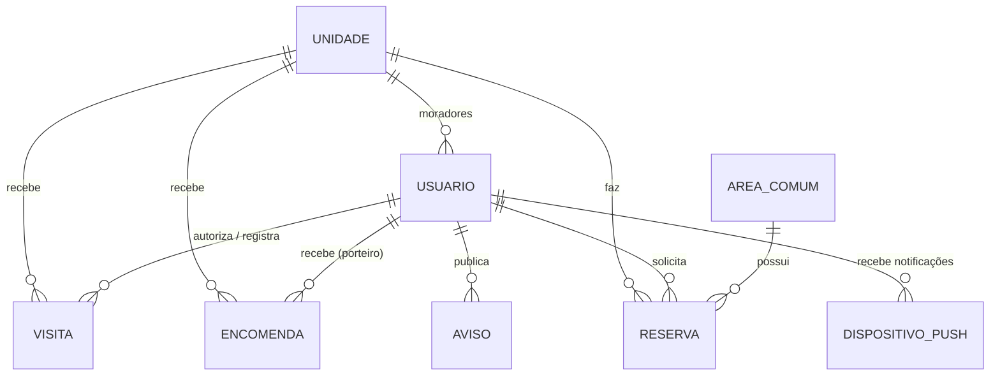

# Requisitos — Condomus

## Perfis de acesso

| Perfil       | Descrição |
|--------------|-----------|
| **Morador**  | Vinculado a uma unidade. Autoriza visitantes, acompanha encomendas, lê avisos e reserva áreas comuns. |
| **Porteiro** | Funcionário da portaria. Registra entrada/saída de visitantes e recebimento/retirada de encomendas. |
| **Síndico**  | Administração. Publica avisos, cancela reservas e tem as permissões da portaria. |

## Requisitos funcionais (MVP)

### Visitantes
- **RF01** — O morador pré-autoriza um visitante (nome, documento, placa, data prevista).
- **RF01a** — Ao autorizar, o morador recebe um convite (cartão em imagem com o nome do visitante, a data, o QR code, o código de 6 caracteres e as instruções), que pode compartilhar com o visitante (WhatsApp etc.). Por privacidade, o cartão não mostra a unidade nem o nome do morador. O código é aleatório e só vale enquanto a visita estiver agendada.
- **RF02** — O morador lista e cancela visitas agendadas da sua unidade.
- **RF03** — A portaria registra a entrada de um visitante pré-autorizado **somente** lendo o QR code do convite com a câmera (ou digitando o código), conferindo os dados e a foto de quem autorizou. A API recusa a entrada sem o código ou com o código de outra visita; convites já usados ou cancelados são recusados. Sem convite, a portaria usa a entrada direta (RF04), após confirmar com o morador.
- **RF04** — A portaria registra a entrada de um visitante sem pré-autorização, informando a unidade.
- **RF05** — A portaria registra a saída do visitante.
- **RF05a** — Os moradores da unidade recebem uma notificação push quando a entrada de um visitante é registrada; tocar nela abre a aba Visitas.

Ciclo de vida: `AGENDADA → EM_ANDAMENTO → FINALIZADA` (ou `AGENDADA → CANCELADA`).

### Encomendas
- **RF06** — A portaria registra o recebimento de uma encomenda para uma unidade.
- **RF07** — O morador consulta as encomendas da sua unidade.
- **RF08** — A portaria registra a retirada, com o nome de quem retirou.
- **RF09** — O morador recebe uma notificação push quando chega uma encomenda; tocar nela abre a aba Encomendas.

### Avisos
- **RF10** — O síndico publica e remove avisos, podendo fixá-los no topo.
- **RF11** — Todos os usuários visualizam o mural de avisos e recebem uma notificação push quando um aviso é publicado (exceto o autor).

### Reservas de áreas comuns
- **RF12** — Todos visualizam as áreas e as reservas confirmadas (disponibilidade).
- **RF13** — O morador solicita a reserva de uma área em um intervalo de horário futuro, sem conflito com outra reserva pendente ou confirmada. O síndico é notificado.
- **RF13a** — O síndico aprova ou recusa (com motivo opcional) as solicitações; o morador é notificado da decisão. Uma solicitação pendente já ocupa o horário; se recusada, o horário é liberado.
- **RF14** — O morador cancela reservas pendentes ou confirmadas da sua unidade; o síndico cancela qualquer reserva, e o morador é notificado.

Ciclo de vida: `PENDENTE → CONFIRMADA` ou `PENDENTE → RECUSADA`; pendentes e confirmadas podem ir para `CANCELADA`.

### Tela inicial do morador
- **RF19** — Ao abrir o app, o morador vê um resumo da unidade: encomendas aguardando retirada, visitantes no condomínio e esperados hoje, a próxima reserva (com a situação) e os 3 avisos mais recentes, com acesso à lista completa. Atalhos abrem direto os formulários de autorizar visitante e de reservar área.

### Cadastros
- **RF15** — O síndico cadastra unidades (bloco e número, sem duplicidade).
- **RF16** — O síndico cadastra moradores (vinculados a uma unidade) e funcionários (porteiro ou síndico), definindo a senha inicial.
- **RF17** — O síndico desativa e reativa contas; uma conta desativada perde o acesso imediatamente. Não há exclusão, para preservar o histórico.

### Conta
- **RF18** — Todo usuário consulta seus dados e troca a própria senha, informando a senha atual.
- **RF20** — Todo usuário pode definir uma foto de perfil (galeria ou câmera, recortada em quadrado e reduzida para 400×400 no app) e removê-la. A foto aparece no cabeçalho, no Início e nos Cadastros; a portaria vê a foto de quem autorizou cada visita e dos moradores da unidade ao registrar a retirada de uma encomenda. Só a própria pessoa, a portaria e o síndico podem ver a foto.
- **RF21** — Quem esqueceu a senha pede um código de 6 dígitos por e-mail (válido por 15 minutos, de uso único) e o usa para definir uma nova senha, sem precisar da senha atual. O pedido não revela se o e-mail tem conta cadastrada.

## Requisitos não funcionais
- **RNF01** — Autenticação por e-mail e senha, com token JWT (validade de 8h) e senhas armazenadas com bcrypt.
- **RNF02** — Toda rota, exceto login, exige autenticação; o acesso é restrito por perfil.
- **RNF03** — O morador só acessa dados da própria unidade.
- **RNF04** — Dados pessoais de visitantes (documento, placa) tratados conforme a LGPD.

## Matriz de permissões (API)

| Endpoint                          | Morador        | Porteiro | Síndico |
|-----------------------------------|----------------|----------|---------|
| `POST /auth/login`                | ✔              | ✔        | ✔       |
| `POST /auth/recuperar-senha`, `/redefinir-senha` | sem login (qualquer um) | | |
| `GET /auth/me`, `PATCH /auth/senha` | ✔            | ✔        | ✔       |
| `PUT /auth/foto`, `DELETE /auth/foto` (própria) | ✔ | ✔        | ✔       |
| `GET /usuarios/:id/foto`          | só a própria   | ✔        | ✔       |
| `GET /unidades/:id/moradores`     |                | ✔        | ✔       |
| `GET /visitas`                    | própria unidade| todas    | todas   |
| `POST /visitas`                   | ✔              |          |         |
| `POST /visitas/entrada-direta`    |                | ✔        | ✔       |
| `PATCH /visitas/:id/entrada`      |                | ✔        | ✔       |
| `PATCH /visitas/:id/saida`        |                | ✔        | ✔       |
| `PATCH /visitas/:id/cancelar`     | própria unidade|          |         |
| `GET /visitas/:id/convite`, `/convite.png` | própria unidade |  |         |
| `GET /visitas/codigo/:codigo`     |                | ✔        | ✔       |
| `GET /encomendas`                 | própria unidade| todas    | todas   |
| `POST /encomendas`                |                | ✔        | ✔       |
| `PATCH /encomendas/:id/retirada`  |                | ✔        | ✔       |
| `GET /avisos`                     | ✔              | ✔        | ✔       |
| `POST /avisos`, `DELETE /avisos/:id` |             |          | ✔       |
| `GET /unidades`                   |                | ✔        | ✔       |
| `POST /unidades`                  |                |          | ✔       |
| `GET /usuarios`, `POST /usuarios` |                |          | ✔       |
| `PATCH /usuarios/:id/ativo`       |                |          | ✔       |
| `PUT /dispositivos`, `DELETE /dispositivos/:token` | ✔ | ✔     | ✔       |
| `GET /resumo`                     | ✔              |          |         |
| `GET /areas`, `GET /reservas`     | ✔              | ✔        | ✔       |
| `GET /reservas/minhas`            | ✔              |          |         |
| `POST /reservas`                  | ✔              |          |         |
| `PATCH /reservas/:id/aprovar`, `/recusar` |        |          | ✔       |
| `PATCH /reservas/:id/cancelar`    | própria unidade|          | ✔       |

## Modelo de dados

O esquema completo está em [apps/api/prisma/schema.prisma](../apps/api/prisma/schema.prisma).

## Limitações conhecidas / próximos passos
- Verificação de conflito de reservas sem bloqueio transacional (duas requisições simultâneas podem passar).
- Push no Android exige um development build (o Expo Go no Android não recebe push desde o SDK 53).

## Telas do aplicativo

| Perfil   | Abas |
|----------|------|
| Morador  | Início (resumo, atalhos e avisos) · Meus visitantes (em aberto + histórico) · Encomendas (na portaria + histórico de retiradas) · Reservas |
| Porteiro | Visitantes (esperados / no condomínio / histórico) · Encomendas · Avisos |
| Síndico  | Avisos (publicar/remover) · Visitantes · Encomendas · Reservas (aprovar, recusar e cancelar) · Cadastros |

O ícone de perfil no topo de todas as telas abre **Minha conta** (dados, troca de senha e sair).

A sessão fica salva no aparelho (`expo-secure-store`) e é encerrada automaticamente quando o token expira.
